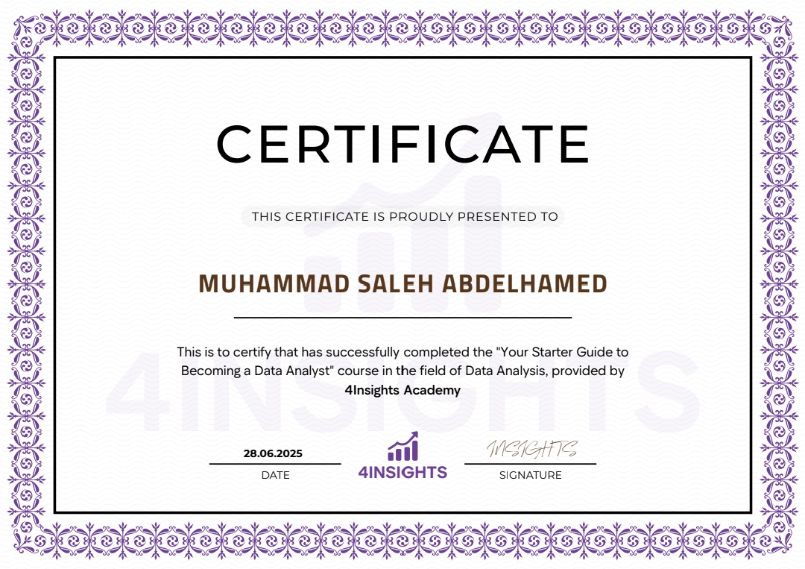
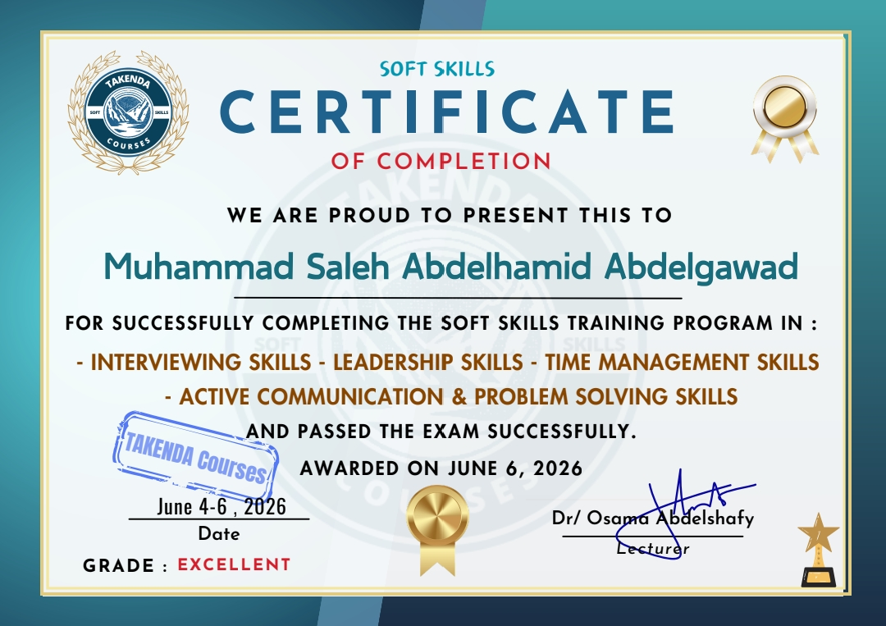
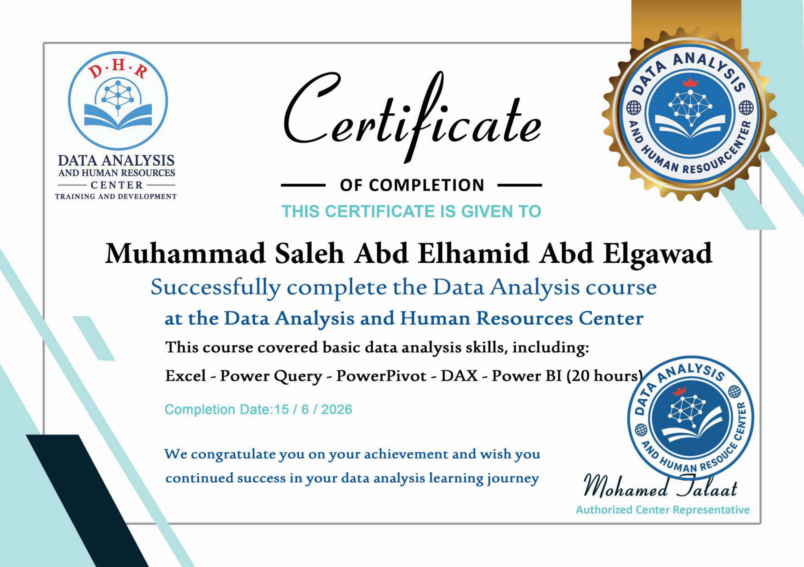

# Hi, I'm Muhammad Saleh 👋

I'm an **Aspiring Data Analyst** passionate about working with data and turning it into meaningful insights.

I'm continuously learning and developing my skills to build a strong foundation in data analysis.

## 🛠️ Skills & Tools

- Microsoft Excel (Advanced)
- Power Query
- PivotTables & PivotCharts
- Excel Formulas (XLOOKUP, VLOOKUP, IF, SUMIFS, COUNTIFS)
- Data Cleaning
- Data Analysis
- Data Visualization
- Power BI
- Dashboard Development

## 📊 Featured Projects

### 1. Bank Customer Churn Analysis
Analyzed customer churn patterns using Excel, exploring customer demographics, account characteristics, and key factors related to customer retention.

[View Project on GitHub](https://github.com/Mohammad-Saleh-88/Bank-Customer-Churn-Analysis)

### 2. Clothing Brand Sales & Profitability Analysis
Built a Power BI report to analyze sales performance, product profitability, orders, and retailer performance, supporting data-driven business decisions.

[View Project on GitHub](https://github.com/Mohammad-Saleh-88/Clothing-Brand-Sales-Analysis)

### 3. Employee Data Analysis & HR Dashboard
Analyzed employee data using Excel and Power Query, applying PivotTables and data visualization to explore workforce demographics, salaries, and performance.

[View Project on GitHub](https://github.com/Mohammad-Saleh-88/Excel-Data-Analysis-Project)

## 🎯 Current Goals

- Expanding my data analysis skills through practical projects.
- Developing my knowledge of SQL, Python, and Statistics.
- Strengthening my ability to transform data into meaningful business insights.

## 📫 Connect with Me

- **LinkedIn:** [My LinkedIn Profile](https://www.linkedin.com/in/muhammad-saleh-87a828410)
- **Email:** md.saleh.3508@gmail.com

---

## 🎓 Certificates & Training

### 1. Your Starter Guide to Becoming a Data Analyst – 4Insights Academy

Successfully completed the introductory course "Your Starter Guide to Becoming a Data Analyst", gaining foundational knowledge of the Data Analysis field.

**Completion Date:** June 28, 2025

---

### 2. Soft Skills Training Program – Takenda Courses

Successfully completed the Soft Skills Training Program and passed the examination with an **Excellent** grade.

Topics covered:

- Interviewing Skills
- Leadership Skills
- Time Management
- Active Communication
- Problem Solving

**Awarded Date:** June 6, 2026

---

### 3. Data Analysis – Data Analysis and Human Resources Center

Successfully completed a 20-hour Data Analysis course covering:

- Microsoft Excel
- Power Query
- Power Pivot
- DAX
- Power BI

**Completion Date:** June 15, 2026

---

### 4. Data Analysis Training – Growth Level Academy

Currently enrolled in a practical Data Analysis training program.

**Completed:**
- Excel
- Power BI

**Currently Learning:**
- SQL
- Python
- Statistics

**Status:** In Progress

